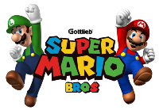
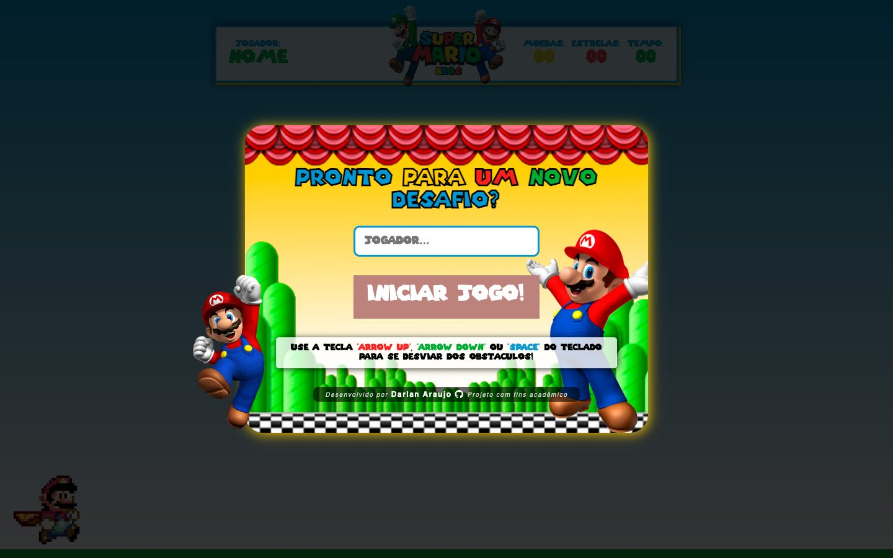
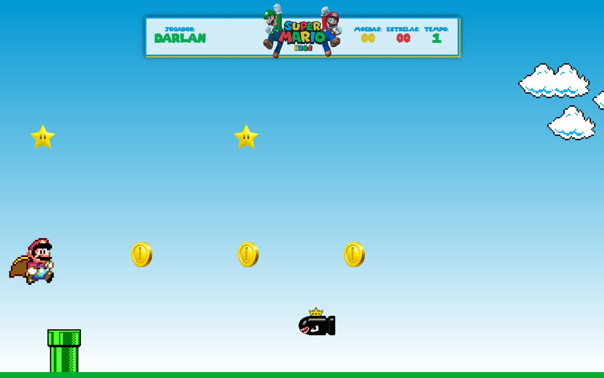

<div align="center">



# Jogo do Mario

**Um jogo de corrida infinita no estilo Super Mario, feito do zero com HTML, CSS e JavaScript puro.**

[**▶ Jogar agora**](https://darlanaraujo.github.io/jogo-mario/) · [Versão refeita para o YouTube (2023)](https://github.com/darlanaraujo/jogo-mario-youtube) · [Série com 42 aulas](https://www.youtube.com/playlist?list=PLCNFRvVK1LVNXTnaPo6MReEwq75VA9WB5)


</div>

<table>
  <tr>
    <td width="50%"></td>
    <td width="50%"></td>
  </tr>
  <tr>
    <td align="center"><sub>A entrada: o jogador digita o nome e começa</sub></td>
    <td align="center"><sub>Em jogo: moedas, estrelas, canos e a bala inimiga</sub></td>
  </tr>
</table>

## Como se joga

| Tecla | O que faz |
|---|---|
| `↑` ou `Espaço` | Mario pula (desvia dos obstáculos e pega moedas e estrelas) |
| `↓` | Mario se abaixa (passa por baixo da bala) |

O objetivo é durar o máximo possível. A cada trecho a velocidade aumenta, e um encontro com cano, planta ou bala
encerra a partida.

## O que o jogo tem

- **Nome do jogador** guardado no navegador (LocalStorage).
- **Tempo, moedas e estrelas** contados ao vivo no placar do topo.
- **Velocidade progressiva:** o jogo começa lento e acelera, com aviso sonoro a cada mudança.
- **Obstáculos variados:** cano, planta e a bala, que exige abaixar em vez de pular.
- **Tela de fim de jogo** com animação.
- **Ranking com os 10 melhores** resultados de tempo e moedas, salvo no próprio navegador.
- **Trilha e efeitos sonoros:** pulo, moeda, estrela, velocidade, fim de jogo e ranking.

## Como foi feito

O ponto de partida foi um vídeo do canal [Manual do Dev](https://www.youtube.com/watch?v=r9buAwVBDhA), que mostra o
básico: o Mario pulando um cano. Daí para a frente, o jogo foi aprimorado por conta própria, a partir de um briefing
escrito antes de começar:

> * O jogador informa o nome, que fica salvo.
> * Um botão de Play inicia a partida.
> * ArrowUp ou Space fazem o Mario pular para desviar dos obstáculos ou pegar as moedas.
> * O jogo conta o tempo até o jogador perder.
> * Ao perder, aparece a tela de game over.
> * No fim, um ranking com os 10 melhores resultados de tempo e moedas.
> * **Bônus:** um nível que começa lento e vai acelerando.

Tudo isso foi entregue, e mais: estrelas, o Mario abaixado, a bala inimiga e os sons de cada evento.

Em 2023 o jogo foi refeito com o código organizado em módulos e ensinado do zero numa
[série de 42 aulas no YouTube](https://www.youtube.com/playlist?list=PLCNFRvVK1LVNXTnaPo6MReEwq75VA9WB5): veja o
[repositório da edição YouTube](https://github.com/darlanaraujo/jogo-mario-youtube).

Projeto feito em 2022, antes das ferramentas de IA para programação: cada linha foi escrita à mão, como estudo de
lógica, animação com CSS e manipulação do DOM.

## Estrutura

```
index.html        a página do jogo
scss/estilo.scss  os estilos (compilados em css/estilo.css)
js/index.js       a lógica: loop do jogo, colisões, placar, velocidade e ranking
images/           personagens, cenário e obstáculos
audio/            trilha e efeitos sonoros
```

Para rodar: baixe o repositório e abra o `index.html` no navegador. Não precisa instalar nada.

## Autoria

Desenvolvido por **[Darlan Araujo](https://github.com/darlanaraujo)**, projeto com fins de estudo.<br>
Super Mario é marca da Nintendo; personagens e sons usados apenas como homenagem, sem fins comerciais.
